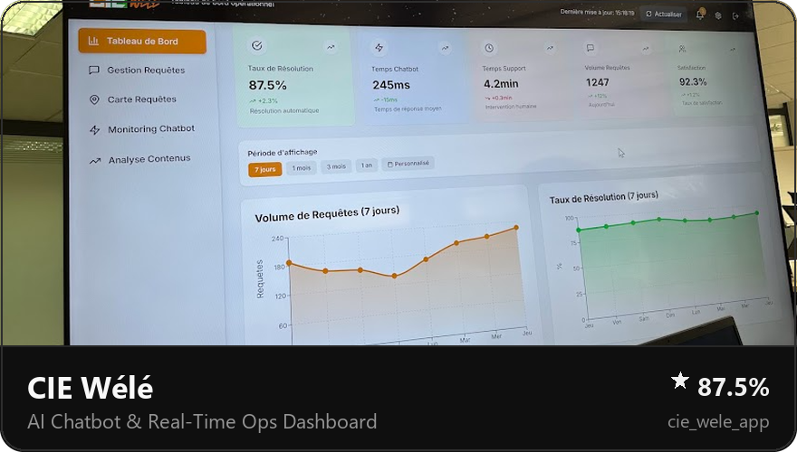
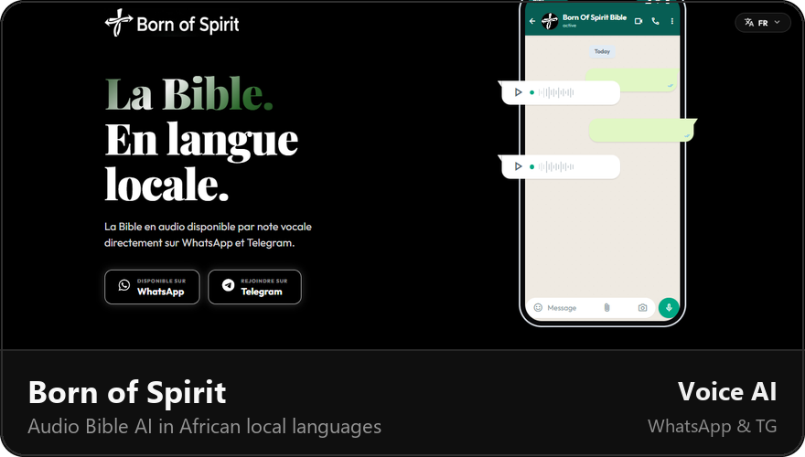
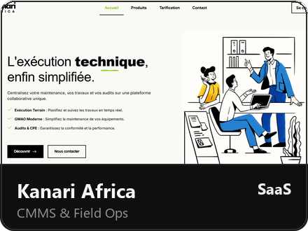
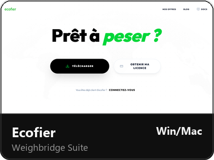
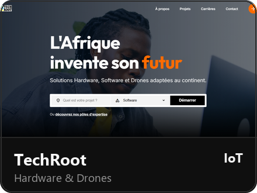
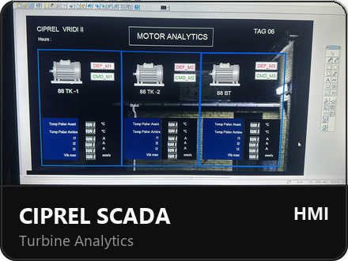
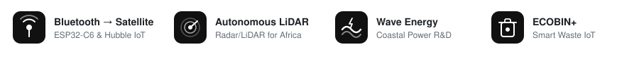

  

  <a href="https://emmanuelgbra.com">emmanuelgbra.com</a> &nbsp;·&nbsp;
  <a href="https://www.linkedin.com/in/korekou-emmanuel-gbra/">LinkedIn</a> &nbsp;·&nbsp;
  <a href="https://kanari.africa">kanari.africa</a> &nbsp;·&nbsp;
  <a href="https://kanari.energy">kanari.energy</a> &nbsp;·&nbsp;
  <a href="https://github.com/Losahfirst">@Losahfirst</a>

  
  

  
  
  
  

 

  Core focus &amp; active R&amp;D

  

